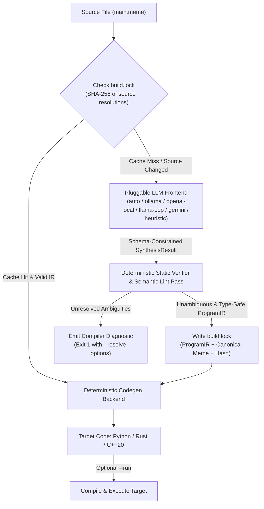

# Memelang (`meme`) — Natural Language Compiler Design Spec

**Date:** 2026-11-03  
**Project:** `memelang` (`meme` CLI, `.meme` source files)  
**Status:** Draft for Review

---

## 1. Overview & Goals

**Memelang** (`meme`) is an experimental natural-language programming language and compiler pipeline where English source files (`.meme`) are translated by a small local LLM (or optional cloud API) into a **strict, strongly-typed Intermediate Representation (IR)**, verified by a **deterministic static analysis pass**, locked into a reproducible **`build.lock`** file, and compiled into target languages (**Python**, **Rust**, and **C++20**).

### Core Design Principles
1. **Hybrid English Syntax:** Developers can write either unambiguous structured English (`define list numbers as 10 random integers between 1 and 100`) or casual freeform English (`array = 10.random numbers`).
2. **Fail-Safe Ambiguity Detection:** When English phrasing is semantically ambiguous or contradictory (e.g., `for each number in array sort from 1 to 10`), the compiler halts before code generation, presents numbered candidate interpretations with their canonical English equivalents, and allows locking the resolution into `build.lock` via `--resolve` or `--interactive`.
3. **LLM in Frontend Only, 100% Deterministic Backends:** The LLM is only used in Phase 1 (`English -> JSON IR`) under strict JSON Schema / grammar constraints (`T=0.0`). Phase 2 (`IR -> Python / Rust / C++20`) is 100% deterministic visitor-based code generation.
4. **Lockfile Reproducibility (`build.lock`):** Once a `.meme` file's IR is synthesized and validated, `build.lock` caches the SHA-256 hash of the source text, resolved ambiguities, canonical English representation, and validated AST. Subsequent builds for any target language bypass the LLM entirely with 0ms inference latency.
5. **Local-First Hardware Target:** Designed to run comfortably on consumer hardware with 6GB VRAM (e.g., NVIDIA GTX 1660 running 1.5B–3B quantized models such as `qwen2.5-coder:3b` or `llama3.2:3b` via Ollama / OpenAI-compatible local server / `llama.cpp`), with an optional Gemini Cloud API provider and a built-in zero-dependency `heuristic` engine for instant offline usage and testing.

---

## 2. System Architecture & Pipeline Flow



### Directory Structure
```text
meme/
├── pyproject.toml
├── README.md
├── examples/
│   ├── random_sort_structured.meme
│   ├── random_sort_ambiguous.meme
│   └── fizzbuzz.meme
├── src/
│   └── memelang/
│       ├── __init__.py
│       ├── cli.py              # CLI commands: compile, run, check, explain, lock
│       ├── ir/
│       │   ├── __init__.py
│       │   ├── schema.py       # Pydantic models for ProgramIR, IRStatement, IRExpr, AmbiguityDiagnostic
│       │   └── canonical.py    # Decompiler from ProgramIR -> Canonical Structured English (.meme)
│       ├── analyzer/
│       │   ├── __init__.py
│       │   └── verifier.py     # Static type checker, scope verifier, & structural ambiguity detector
│       ├── llm/
│       │   ├── __init__.py
│       │   ├── base.py         # LLMProvider protocol & system prompt / few-shot builder
│       │   ├── heuristic.py    # Zero-dependency local parser/synthesizer for structured & common English
│       │   ├── ollama.py       # Ollama & OpenAI-compatible local HTTP client with JSON Schema
│       │   ├── llama_cpp.py    # Optional in-process GGUF runner via llama-cpp-python
│       │   └── gemini.py       # Optional Google Gemini API client via google-genai SDK
│       ├── lockfile/
│       │   ├── __init__.py
│       │   └── manager.py      # Reads/writes build.lock, hashes source, applies --resolve choices
│       ├── codegen/
│       │   ├── __init__.py
│       │   ├── python_gen.py   # ProgramIR -> Python 3
│       │   ├── rust_gen.py     # ProgramIR -> Standalone Rust (rustc compatible)
│       │   └── cpp_gen.py      # ProgramIR -> C++20 (g++ -std=c++20 compatible)
│       └── runner/
│           ├── __init__.py
│           └── executor.py     # Compiles & runs generated Python, Rust, or C++20 in temp build dir
└── tests/
    ├── test_ir_and_canonical.py
    ├── test_static_verifier.py
    ├── test_lockfile_and_resolve.py
    ├── test_codegen_targets.py
    └── test_cli_e2e.py
```

---

## 3. Intermediate Representation (IR) Schema

The IR is defined using **Pydantic v2** models in `src/memelang/ir/schema.py`. It serves two roles:
1. Providing the strict JSON Schema enforced on LLM output (`SynthesisResult`).
2. Serving as the verified AST (`ProgramIR`) consumed by the code generators.

### 3.1 Static Type System (`MemeType`)
Every variable, expression, and function parameter resolves to one of:
* `Int` (64-bit signed integer)
* `Float` (64-bit floating point)
* `Bool` (boolean)
* `String` (UTF-8 string)
* `List<Int>`, `List<Float>`, `List<String>`, `List<Bool>`
* `Void` (function return type only)

### 3.2 Expressions (`IRExpr`)
Discriminated by `expr_type`:
* **`LiteralExpr`**: `{"expr_type": "literal", "value": int | float | bool | str, "data_type": MemeType}`
* **`ListLiteralExpr`**: `{"expr_type": "list_literal", "elements": list[IRExpr], "element_type": MemeType}`
* **`VarRefExpr`**: `{"expr_type": "var_ref", "name": str}`
* **`RandomIntExpr`**: `{"expr_type": "random_int", "min_val": IRExpr, "max_val": IRExpr}`
* **`RandomListExpr`**: `{"expr_type": "random_list", "count": IRExpr, "min_val": IRExpr, "max_val": IRExpr, "implicit_bounds": bool}`
* **`BinaryOpExpr`**: `{"expr_type": "binary_op", "op": "+" | "-" | "*" | "/" | "%" | "==" | "!=" | "<" | "<=" | ">" | ">=" | "and" | "or", "left": IRExpr, "right": IRExpr}`
* **`UnaryOpExpr`**: `{"expr_type": "unary_op", "op": "-" | "not", "operand": IRExpr}`
* **`ListLengthExpr`**: `{"expr_type": "list_length", "target": IRExpr}`
* **`ListIndexExpr`**: `{"expr_type": "list_index", "target": IRExpr, "index": IRExpr}`
* **`CallExpr`**: `{"expr_type": "call", "func_name": str, "args": list[IRExpr]}`
* **`ReadInputExpr`**: `{"expr_type": "read_input", "prompt": str, "target_type": MemeType}`

### 3.3 Concrete Statements (`IRStatement`)
Discriminated by `op`:
1. **`VarDeclStmt` (`op: "var_decl"`)**:
   * `name: str`
   * `var_type: MemeType`
   * `value: IRExpr`
   * `source_line: int | None`
2. **`AssignStmt` (`op: "assign"`)**:
   * `name: str`
   * `value: IRExpr`
3. **`SortCollectionStmt` (`op: "sort_collection"`)**:
   * `target: str`
   * `direction: Literal["ascending", "descending"]`
4. **`ClampCollectionStmt` (`op: "clamp_collection"`)**:
   * `target: str`
   * `min_val: IRExpr`
   * `max_val: IRExpr`
5. **`FilterCollectionStmt` (`op: "filter_collection"`)**:
   * `target: str`
   * `item_var: str`
   * `predicate: IRExpr`
6. **`ListAppendStmt` (`op: "list_append"`)**:
   * `target: str`
   * `value: IRExpr`
7. **`PrintStmt` (`op: "print_stmt"`)**:
   * `expressions: list[IRExpr]`
8. **`IfStmt` (`op: "if_stmt"`)**:
   * `condition: IRExpr`
   * `then_body: list[IRStatement]`
   * `else_body: list[IRStatement]`
9. **`ForEachStmt` (`op: "for_each"`)**:
   * `item_var: str`
   * `collection: str`
   * `body: list[IRStatement]`
10. **`ForRangeStmt` (`op: "for_range"`)**:
    * `loop_var: str`
    * `start: IRExpr` (inclusive)
    * `end: IRExpr` (inclusive)
    * `body: list[IRStatement]`
11. **`WhileStmt` (`op: "while_loop"`)**:
    * `condition: IRExpr`
    * `body: list[IRStatement]`
12. **`FuncDefStmt` (`op: "func_def"`)**:
    * `name: str`
    * `params: list[FuncParam]` (`name: str`, `param_type: MemeType`)
    * `return_type: MemeType`
    * `body: list[IRStatement]`
13. **`ReturnStmt` (`op: "return_stmt"`)**:
    * `value: IRExpr | None`

### 3.4 Self-Contained Ambiguity Diagnostic (`AmbiguityDiagnostic`)
In `SynthesisResult`, top-level items can include `AmbiguityDiagnostic` objects alongside `statements`:
* `statement_id: int` (1-based index of the ambiguous statement/block)
* `source_line: int`
* `source_text: str`
* `reason: str`
* `candidates: list[AmbiguityCandidate]`, where each `AmbiguityCandidate` contains:
  * `option: int` (1, 2, 3...)
  * `description: str` (human-readable explanation of intent)
  * `canonical_meme: str` (unambiguous Structured English code)
  * `replacement_ir: list[IRStatement]` (complete replacement AST nodes for this statement—or whole-program replacement when an option modifies an earlier declaration such as restricting random range bounds)
  * `replaces_whole_program: bool = False`

Because each `AmbiguityCandidate` embeds its own `replacement_ir`, resolving an ambiguity via `meme compile main.meme --resolve 2=1` applies the selected `replacement_ir` deterministically without making another LLM call.

---

## 4. Two-Layer Ambiguity Detection & Static Verifier

Located in `src/memelang/analyzer/verifier.py`, the static verifier runs on every `SynthesisResult` before a `ProgramIR` can be locked or compiled.

### Layer 1: LLM-Flagged Ambiguities
The LLM prompt instructs the model to emit an `AmbiguityDiagnostic` whenever source phrasing has conflicting interpretations (e.g., combining an element-wise loop with a whole-collection sort or specifying numeric bounds in a sort clause).

### Layer 2: Deterministic Structural & Type Verification
Small local models (1.5B–3B) may sometimes translate ambiguous English literally into defective AST nodes instead of emitting an `AmbiguityDiagnostic`. The deterministic verifier inspects the AST and catches:

1. **Loop / Collection-Mutation Collision:**
   * *Pattern:* A `ForEachStmt` iterating over `collection="X"` whose `body` mutates or sorts `"X"` (e.g., `SortCollectionStmt(target="X")`), or a `SortCollectionStmt` accompanied by dangling range bounds `[A, B]`.
   * *Action:* Automatically transforms the defective AST node into an `AmbiguityDiagnostic` offering concrete candidate AST replacements:
     1. Mutate `X` in-place by sorting all elements in ascending order (`sort X ascending`).
     2. Clamp each element in `X` to `[A, B]` and sort ascending (`clamp X between A and B; sort X ascending`).
     3. Restrict the initial random generator of `X` to `[A, B]` and sort ascending (`define list X as N random integers between A and B; sort X ascending`).
2. **Scope & Undeclared Variable Checking:**
   * Tracks symbol tables across global, function, and loop scopes. Raises a `StaticVerificationError` with source line context if a statement references or mutates an undeclared variable.
3. **Static Type Checking:**
   * Verifies that collection operations (`sort_collection`, `clamp_collection`, `filter_collection`, `list_append`, `for_each`) target variables of `List<T>` type.
   * Verifies arithmetic operations (`+`, `-`, `*`, `/`, `%`) operate on numeric types (`Int` / `Float`) and boolean conditions resolve to `Bool`.

---

## 5. Lockfile (`build.lock`) Specification

`build.lock` is a deterministic, human-inspectable JSON file stored alongside the project (or specified via `--lockfile`).

```json
{
  "lockfile_version": 1,
  "entries": {
    "main.meme": {
      "source_sha256": "e3b0c44298fc1c149afbf4c8996fb92427ae41e4649b934ca495991b7852b855",
      "provider": "ollama:qwen2.5-coder:3b",
      "resolutions": {
        "2": 1
      },
      "pending_ambiguities": [],
      "canonical_meme": "define list array as 10 random integers between 1 and 100\nsort array ascending\nprint array",
      "ir": {
        "statements": [...]
      }
    }
  }
}
```

### Lockfile Lifecycle
1. **Unambiguous Source:** Computes `source_sha256`. On cache miss, runs Frontend + Static Verifier, writes `ir` and `canonical_meme` to `build.lock`, and proceeds to Codegen.
2. **Ambiguous Source (No `--resolve`):** Writes `pending_ambiguities` to `build.lock` so the user can resolve them immediately on the next CLI invocation without re-running the LLM. Exits with code `2` and prints the diagnostic table.
3. **Ambiguous Source (With `--resolve <id>=<option>` or `--interactive`):** Looks up `pending_ambiguities` in `build.lock` (if `source_sha256` matches), applies the chosen candidate's `replacement_ir`, runs the Static Verifier, promotes the result to `ir`, clears `pending_ambiguities`, records `"resolutions": {"<id>": <option>}`, and proceeds to Codegen.

---

## 6. Pluggable LLM Frontend Providers

All providers live in `src/memelang/llm/` and implement:
```python
class LLMProvider(Protocol):
    name: str
    def synthesize(self, source_text: str) -> SynthesisResult: ...
```

1. **`auto` (Default):**
   * Checks if a local Ollama server (`OLLAMA_HOST` or `http://127.0.0.1:11434`) is reachable with a local coder model, or if `MEME_PROVIDER` is configured; falls back cleanly to `heuristic` for offline zero-setup execution if no LLM daemon or API key is configured (while logging the active provider).
2. **`ollama` / `openai-local`:**
   * Calls `/api/chat` (Ollama) or `/v1/chat/completions` (OpenAI-compatible local server like `llama-server` or LM Studio) with `temperature: 0.0`, `seed: 42`, and `format: SynthesisResult.model_json_schema()`.
   * Default recommended model for 6GB VRAM (GTX 1660): `qwen2.5-coder:3b` (~2.0 GB VRAM in Q4_K_M).
3. **`llama-cpp`:**
   * Optional in-process GGUF model loader using `llama-cpp-python` (`response_format={"type": "json_object", "schema": SynthesisResult.model_json_schema()}`).
4. **`gemini`:**
   * Cloud API option using `google-genai` (`gemini-2.5-flash`) with `response_mime_type="application/json"` and `response_schema=SynthesisResult`.
5. **`heuristic`:**
   * Built-in deterministic natural-language pattern & grammar synthesizer supporting Canonical Structured English and common freeform English patterns (including `10.random numbers`, loops, conditionals, functions, arithmetic, and ambiguity detection). Guarantees `meme` works out-of-the-box offline with zero external dependencies.

---

## 7. Target Code Generators & Runner

All code generators in `src/memelang/codegen/` are pure functions `generate_*(ir: ProgramIR) -> str`:

1. **Python (`python`):**
   * Uses `random.randint(min, max)`, list comprehensions, `.sort(reverse=...)`, `min(max(x, lo), hi)` for clamping, and `print(...)`.
2. **Rust (`rust`):**
   * Emits standalone, zero-external-crate Rust code so `rustc` can compile single `.rs` files directly without needing network access or a `Cargo.toml` dependency download.
   * Includes a lightweight, seeded or system-time-seeded splitmix64 PRNG helper when `random_int` / `random_list` is used, and uses standard `Vec<T>`, `.sort()`, `.sort_by(...)`, `.clamp(lo, hi)`, and `println!`.
3. **C++20 (`cpp`):**
   * Emits standard C++20 using `<iostream>`, `<vector>`, `<string>`, `<random>`, `<algorithm>`, `std::mt19937`, `std::uniform_int_distribution`, `std::ranges::sort`, and `std::clamp`.

### CLI Commands (`meme`)
* `meme compile <file.meme> --target <python|rust|cpp> [-o <out>] [--provider <name>] [--resolve <id=opt>] [--interactive]`
* `meme run <file.meme> --target <python|rust|cpp> [--provider <name>] [--resolve <id=opt>]`
* `meme check <file.meme>` — Runs frontend + static verifier and prints either ambiguity warnings or verification success.
* `meme explain <file.meme>` — Outputs the Canonical Structured English (`canonical_meme`) and lock status for `<file.meme>`.

---

## 8. Error Handling & Testing Plan

### Error Handling
* `AmbiguityError` (Exit code `2`): Formatted compiler warning listing numbered candidate interpretations, their `canonical_meme` previews, and the exact `--resolve <id>=<opt>` flag to run.
* `StaticVerificationError` (Exit code `1`): Clear type or scope error with statement index and source text.
* `LLMProviderError` (Exit code `3`): Actionable message when an explicitly requested provider (e.g., `--provider=ollama` or `--provider=gemini`) is unreachable or missing credentials.

### Verification Suite (`pytest`)
1. **Unit — IR & Canonical Decompiler (`tests/test_ir_and_canonical.py`):** Round-trip serialization of all IR statements/expressions and canonical English formatting.
2. **Unit — Static Verifier & Ambiguity Safety Net (`tests/test_static_verifier.py`):** Verifies type checking, undeclared variable catching, and automatic transformation of loop+sort structural collisions into `AmbiguityDiagnostic`.
3. **Unit — Lockfile & Zero-LLM Resolution (`tests/test_lockfile_and_resolve.py`):** Verifies SHA-256 caching, `pending_ambiguities` persistence, and resolving ambiguities without invoking the LLM provider.
4. **Integration — Multi-Target Codegen & Execution (`tests/test_codegen_targets.py`):** Compiles and executes sample programs across **Python 3**, **Rust (`rustc`)**, and **C++20 (`g++`)**, asserting valid compilation and expected stdout.
5. **E2E — CLI Workflow (`tests/test_cli_e2e.py`):** Tests both the structured English example and the ambiguous `array = 10.random numbers / for each number in array sort from 1 to 10` workflow end-to-end through the `meme` CLI.
